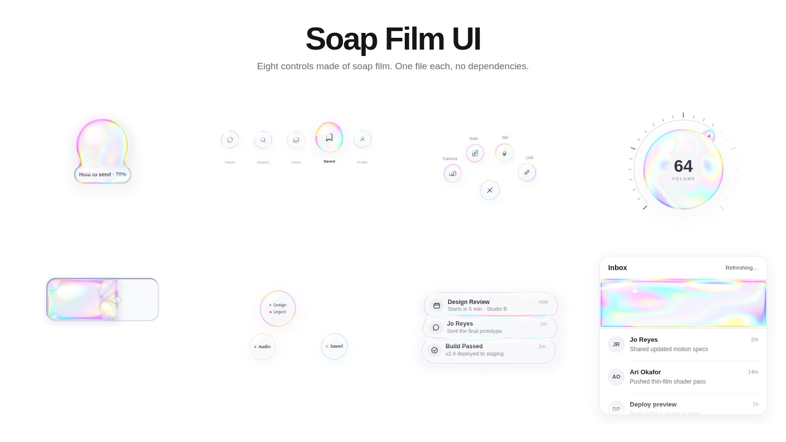

# Soap Film UI

Ordinary UI controls made of soap film. The slider's fill is a pane of soap that stretches and swirls as you drag it. Holding the button blows a bubble until it bursts. The menu pours its soap from one bubble into the next. The colour is real thin-film interference, worked out from how thick the soap is at each point, and the thickness is a small fluid simulation that your hand stirs.

Each control is a single file that defines a custom element, with its WebGL2 shaders and its simulation inside it, so there is nothing else to fetch. Under each drawing is a real control, so they work with a keyboard, a screen reader and a form. No dependencies, no build step for you, MIT licensed.



## The eight

| | element | what it does |
|---|---|---|
| [Slider](slider/) | `<soap-slider>` | The filled part of the track is a pane of soap film. Drag and it stretches and swirls; let go and bubbles bloom in its corners and coalesce back into it. |
| [Hold to send](hold-button/) | `<soap-hold-button>` | Press and hold and the film on the button blows up into a bubble. Hold to the end and it bursts and says Sent. |
| [Pull to refresh](pull-refresh/) | `<soap-pull-refresh>` | Pull the list down and the gap fills with a sheet of soap the shape of the opening. It swells while it loads, then pops. |
| [Bubble menu](menu/) | `<soap-menu>` | Five bubbles; the chosen one is bigger. Pick another and the soap flows across to it, through every bubble in between. |
| [Action button](fab/) | `<soap-fab>` | One bubble that buds into four action bubbles, shrinking as it gives them its soap, and fuses back when it closes. |
| [Notification stack](notifications/) | `<soap-notifications>` | Notifications as a foam, flattened against each other along shared walls. Flick one and it pops; the rest close up. |
| [Tag bubbles](tags/) | `<soap-tags>` | Drag one tag into another and they coalesce into one bubble; pull one out and it tears off again. |
| [Rotary dial](dial/) | `<soap-dial>` | A knob that is a disc of soap. Turn it and the film spins into a vortex that follows your hand. |

## The look

Pure white, with each control in a hairline frame of glass or wire. The soap is mostly clear in the middle and bright at the edges, where light catches a curve: a coloured rim, one hard highlight, and bands of colour that drift with the fluid. Forms are stylized and puffed up so they read at a glance; the effects are physical. Things happen when the motion stops (the slider's edge bubbles), and pops tear open from one point with a beaded rim rather than fading.

Each one makes soft synthesized sounds as it is used (pops, ticks, a glide, a rising tension), after the first tap on the page. There are no audio files.

## Try them

Live: https://soap-film-ui.vercel.app

Or run it yourself:

```sh
python3 -m http.server 8000     # from this folder
# open http://localhost:8000/
```

That opens the gallery, with all eight live.

## Use one

Each is a single file that defines an element. Install it with the shadcn CLI, which puts the file in `public/soap-film-ui/`:

```sh
npx shadcn add finktheartist/soap-film-ui/slider
npx shadcn add finktheartist/soap-film-ui/hold-button
npx shadcn add finktheartist/soap-film-ui/menu
# ...pull-refresh, fab, notifications, tags, dial
```

Or copy the file into your project by hand. Then load it with a plain script tag and use its element:

```html
<script src="slider.js"></script>
<soap-slider value="40" label="Volume"></soap-slider>

<script src="hold-button.js"></script>
<soap-hold-button label="Hold to send" done-label="Sent"></soap-hold-button>   <!-- listen for confirm -->

<script src="menu.js"></script>
<soap-menu label="Main">
  <option value="home" selected>Home</option>
  <option value="search">Search</option>
  <option value="inbox">Inbox</option>
  <option value="saved">Saved</option>
  <option value="profile">Profile</option>
</soap-menu>
```

Each folder's README lists the attributes, properties and events. The value controls (slider, dial, menu, tags) work inside a `<form>` like the native ones.

- **Size.** Each fills the width it is given, up to 640 pixels, and sets its own height. They are drawn for a white page.
- **Sound.** `SoapFilm.sound = false` mutes the page; a `muted` attribute mutes one control.
- **How the files share.** Each file carries its engine and a copy of the core (the clock, the sound and the element base class, about 23 KB). The first one loaded sets `window.SoapFilm` and the others reuse it, so any mix on a page shares one clock. The files are between 63 and 95 KB.

For agents, [llms.txt](llms.txt) lists every file and what it is. In the gallery each control has its install line and a "Copy a prompt" button; the prompt points a coding agent at the real file and tells it to wire it in, not rewrite it.

## Make your own

`skills/soap-film-ui/` is the workflow these were made by, written as a skill for a coding agent. Install it with:

```sh
npx skills add finktheartist/soap-film-ui
```

Or copy the folder into your agent's skills folder by hand (for Claude Code, `~/.claude/skills/`). It has:

- `SKILL.md`, the workflow and the rules: pick the soap behaviour that already does the control's job, let effects arrive when motion stops, keep the soap when bubbles grow and shrink.
- `core.js`, the core every component is built on.
- `starter.html`, the smallest whole example: a bubble button on a wire ring, with its own thin-film shader and a 32 by 32 fluid grid.
- `look.mjs`, which stops the clock, steps an interaction to chosen moments and saves the frames side by side.

An agent with the skill gets a reasonable first pass. These took many rounds of looking at stopped frames, and yours will too.

[making-of/](making-of/) is how the set got from four concept sheets to eight controls: what made the soap read as soap, and the real soap behaviour behind each control.

## Working on this repo

- Each component file is put together by `node tools/build.mjs` from four parts: a header, `core.js` (with `src/sound.js` inside it), the engine in `src/engines/NAME.js` (its shaders and simulation) and the element in `src/elements/NAME.js`. Edit those, not the files in the control folders. `node tools/build.mjs --check` exits 1 if any file is out of date.
- `tools/spec.mjs` says what each component is. `node tools/docs.mjs` writes every folder's `README.md` and `index.html`, the gallery, `registry.json` and `llms.txt` from it, so edit the spec and not those files.
- `node tools/test.mjs http://localhost:8000/gallery/` drives every control with real touch and key events at phone width, checks form values, sideways scroll and that every WebGL context is still alive, and exits 1 on a failure. It needs Chrome or Chromium (`CHROME=...` if it is somewhere unusual).
- `node tools/shot.mjs URL OUT W H` takes a screenshot; `tools/title.html` is the title card.

## Limits

- **Checked in headless Chromium,** with real touch and key events and frame-by-frame sheets. Not yet tried in Safari or Firefox, on a real phone, or with a screen reader.
- **Needs WebGL2,** one context per control. Browsers allow about sixteen at once, so keep it to a dozen or so on a page.
- **Drawn for a white page.** On a dark or coloured background it looks wrong.
- **Redraws on resize.** The simulation starts again at the new size, keeping the value but not the motion; the tags' grouping starts over.
- **Fixed counts and drawn icons.** The menu is always five bubbles, the action button four, the tags and notifications at most four, each with a small set of drawn icons. Labels are drawn in the canvas in the system font, so keep them short.
- **Not still for reduced motion.** The film is always moving a little; `prefers-reduced-motion` is not honoured yet.

## License

MIT. See [LICENSE](LICENSE). Everything in the components is drawn by code; no images are used. The four concept sheets in `making-of/` were generated with Gemini's image generation for this project.
