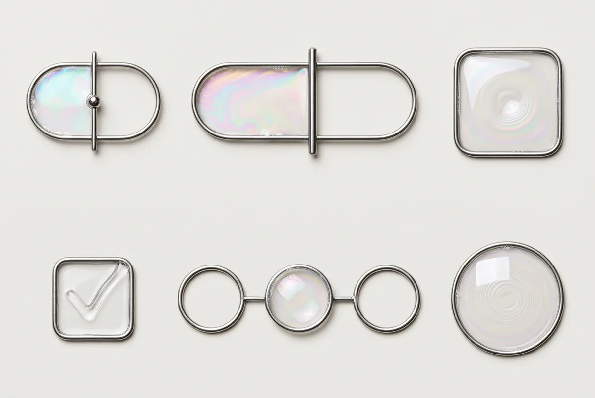
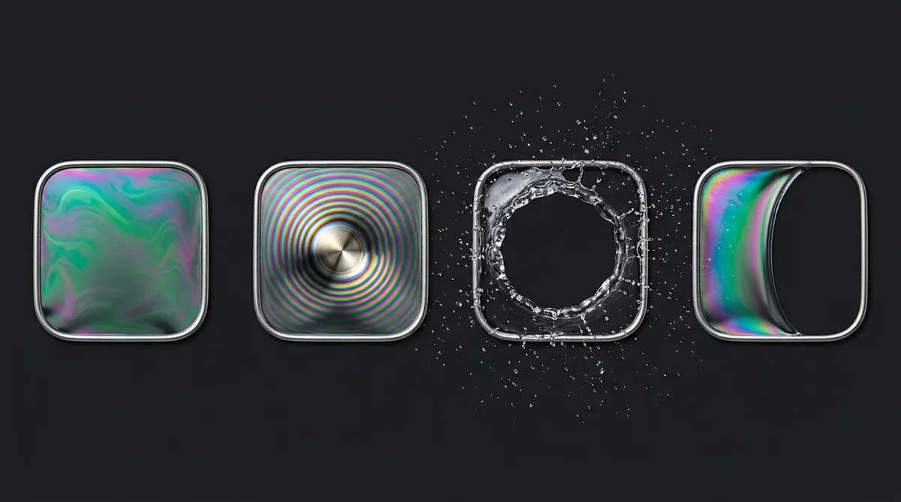

# How it was made

Soap Film UI has no painted art. Every pixel of a control is drawn each frame by a shader, from a small fluid simulation of how thick the soap is at each point. This is how the set got from a concept sheet to eight controls. The four concept prompts are in [prompts.md](prompts.md).

## 1. The idea, and four sheets

The set started as one of six directions for a new kit; soap film was picked. Before any code, four concept sheets were generated to decide what a soap control is: a hairline frame holding a pane of film, with interference colour that moves. One sheet put the same three controls on light and on dark, one storyboarded a pop in four frames, and one put the controls on an instrument panel to see whether they could sit among ordinary type.

| | |
|---|---|
|  |  |

What carried through: the frame as a thin line, the pop as a tear with a beaded rim rather than a fade, and the film taking the shape of whatever holds it.

## 2. Making it look like soap

The first live version was a flat film in a wire frame, with physically correct colour. It was nearly invisible: real soap is mostly clear, and correct colour on a flat pane reads as a rainbow gradient. Five rounds followed:

1. **Real optics.** Colour only where light catches: a Fresnel rim, reflections of a studio window, dimples and menisci. The middle of a flat pane nearly clear.
2. **Volume.** Three reference images of stylised bubbles (other people's art, so not in this repo), all puffed and three-dimensional with bold rims, led to "stylized forms, realistic effects": every control became a plump bubble, exaggerated enough to read.
3. **Edge bubbles.** On the slider, bubbles that gather where the film meets its frame. First they were always there; the note was that they should bubble up only when the control stops moving, and be gone while it moves.
4. **Frameless.** The steel frames were swapped for a hairline of glass.
5. **On white.** The light and dark stages were dropped for pure white, where the set lives now.

Then smaller foam cells and tiny bubbles were added round the edge bubbles, and the slider was done.

## 3. One phenomenon per control

Each control after the slider started from a real thing soap does that already does the control's job.

| control | the soap behind it |
|---|---|
| Slider | Film stretched on a wand; edge bubbles that coalesce back into the pane when it rests. |
| Hold to send | Blowing a bubble: a film inflated through a ring until it bursts. |
| Pull to refresh | A film spanning an opening, first as a catenoid neck, then, after the note "it's the same shape as the opening from the start", as a flat rectangle exactly the shape of the gap. It swells to fill the frame before it pops. |
| Bubble menu | Two bubbles joined by a neck exchange soap; the size flows from the old choice to the new one, through every bubble between, keeping the total area. |
| Action button | Budding: four bubbles pinch off one large one, which shrinks so that the volume is kept. |
| Notification stack | Foam: walls between neighbours meet at 120 degrees (Plateau's laws), and a popped cell lets its neighbours relax. |
| Tag bubbles | Coalescence when two bubbles touch, and tearing a bubble off a cluster. |
| Rotary dial | A spinning film: the fluid is driven round by the hand into a vortex that winds tighter with speed. |

## 4. The engine

Every control has the same three layers, and each has its own copy of them, tuned for it:

- **A fluid grid,** 64 to 80 cells a side on the CPU: thickness, velocity, pressure and curl. Each step advects, adds forces from the pointer (a shear along a drag, a vortex where it turns, a jet where it blows), projects, diffuses a little, and lets gravity drain the top thinner. Thickness goes up to the GPU as a texture every frame.
- **A fragment shader** that draws the bubble shapes as signed distance fields, works out a surface normal for the dome, and colours it with thin-film interference: reflectance at six wavelengths through soap of that thickness, at that angle, mixed to RGB.
- **A 2D canvas** over and under it for the labels, icons, droplets and small floating bubbles.

The sound is synthesized with Web Audio as it plays: filtered noise and sine sweeps for pops, ticks and fizz, and two continuous voices for glide and tension. There are no audio files.

## 5. From pages to components

The controls were built as demo pages, each with its own animation loop and hard-coded content. To make them components:

- each became a custom element that builds its engine at the width it is given and rebuilds it when the width changes;
- one clock drives every control on a page, and a control off screen is not stepped or drawn;
- each got a real control underneath (a range input, a button, radio inputs) for the keyboard, screen readers and forms;
- the lists (menu items, actions, tags, notifications, feed rows) come from the page instead of being written into the engine.
