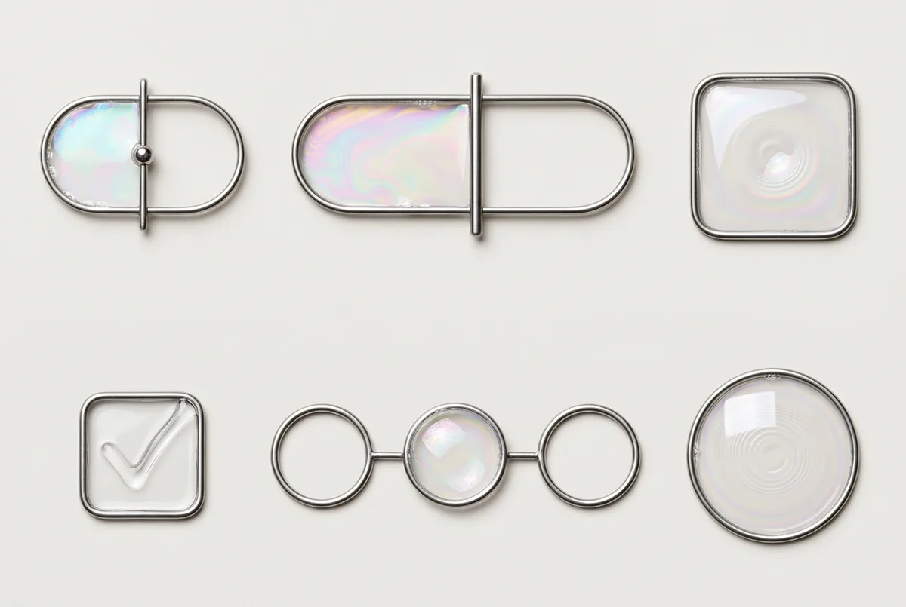
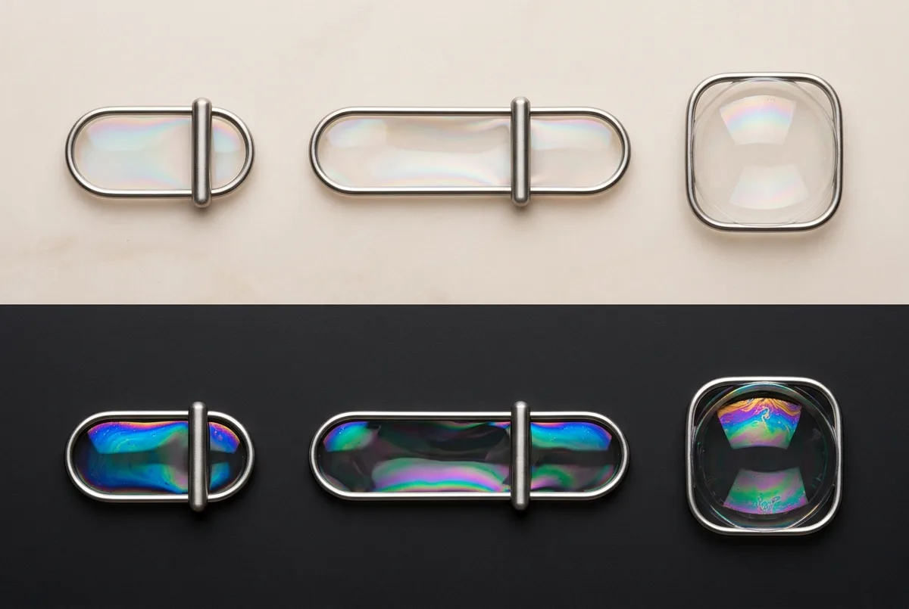
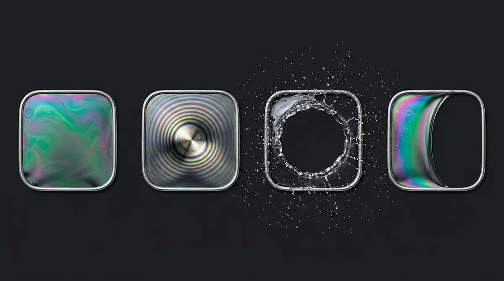
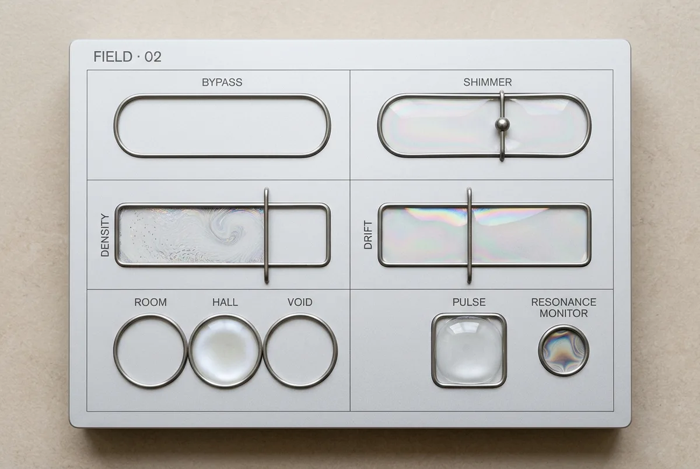

# Prompts

Every image generated for Soap Film UI, with its prompt word for word. There are only four, and none of them is in a component: they were the first concept sheets, made before any code, to decide how a control made of soap could look. Everything in the components is drawn by shaders and code.

They were made on 2026-11-21 by a coding agent (Gemini, in an agent harness) with its built-in image generation. The original files carry Google's content credentials; the smaller copies here were resized and have no metadata. The settings were the harness defaults; the aspect ratio was asked for in the prompt. Each prompt ended with a line naming where to save the file on the machine that made it; that line is left out here.

## 1. The family sheet

> Generate a clean, crisp, strictly top-down orthographic studio photograph (3:2 horizontal aspect ratio) of six minimalist tactile UI controls arranged neatly in a 3-column × 2-row grid on a flat pale warm-stone studio backdrop (#F1F0EC) with crisp gallery lighting and subtle soft wire shadows. ZERO text, ZERO letters, ZERO numbers, ZERO labels, ZERO perspective tilt.
>
> Theme: SOAP FILM (Matching slender brushed-stainless-steel precision wireframe loops holding taut, gossamer, translucent iridescent liquid soap membranes with organic swirling Marangoni thin-film interference currents—pastel opal cyan, rose-pink, pale gold, soft violet, and gleaming wet liquid menisci).
>
> Top row (left to right):
> 1. Toggle (ON): Pill-shaped continuous thin brushed-steel wire loop with one vertical sliding steel crossbar + silver bead near the right end; iridescent translucent soap film stretched from the left rim to the crossbar, empty open air to the right.
> 2. Slider (~60%): Wide horizontal rounded-rectangle thin brushed-steel wire loop with one vertical sliding steel wand bar at 60%; taut swirling Marangoni soap membrane stretched to the left of the wand, empty open air to the right.
> 3. Button (dimpled): Rounded-square slender steel wire loop filled completely with a glossy iridescent soap film showing a subtle off-center circular dimple with concentric pearlescent interference ripples.
>
> Bottom row (left to right):
> 4. Checkbox (checked): Small rounded-square slender steel wire loop filled with translucent soap film, with a crisp V-shaped Plateau-border liquid ridge inside the film catching a bright glossy specular checkmark reflection.
> 5. Radio group (3 rings, middle selected): Three equal circular brushed-steel wire rings linked horizontally by slim straight steel connector wires—the left and right rings are bare open empty wire, while the middle circular ring holds a luminous swirling iridescent soap membrane with tiny glistening droplets along the joint.
> 6. Agent Thinking Ring: A single circular brushed-steel bubble-wand wire ring filled with a hypnotic translucent soap membrane alive with swirling concentric Marangoni interference ribbons and a crisp studio window highlight.
>
> Aesthetic: Ultra-consistent slender brushed stainless steel wire gauge across all six controls, museum-grade optical physics, truly transparent wet gossamer soap membranes—never opaque plastic. Generous clean margin around and between all six controls.

## 2. Light against dark

> Generate a clean, crisp, strictly top-down orthographic split-surface studio lighting study (3:2 horizontal aspect ratio) comparing the EXACT same three Soap Film UI controls on two studio surfaces stacked cleanly top and bottom with a crisp horizontal horizon split right across the center. ZERO text, ZERO labels, ZERO perspective tilt.
>
> Top half (Light studio surface — flat pale warm-stone alabaster #F1F0EC): Three minimalist controls side-by-side horizontally—left: pill brushed-steel wire toggle with sliding bead bar stretching a delicate pastel-opal translucent soap film; center: horizontal wire slider with sliding wand stretching a shimmering pearlescent soap membrane; right: rounded-square wire button filled with gossamer dimpled soap film. Soft crisp gallery lighting, subtle pastel rainbow interference (pearl cyan, blush pink, pale gold), delicate soft drop shadows.
>
> Bottom half (Dark studio surface — flat deep matte charcoal obsidian #141518): The EXACT SAME three slender brushed-steel wire controls aligned directly underneath in the exact same positions and sizes—left pill toggle, center horizontal slider, right rounded-square button—now seen against dark velvet obsidian so the thin-film interference inside the translucent soap membranes glows with breathtaking, authentic physical jewel iridescence (vivid emerald, electric cobalt, molten gold, ultraviolet, magenta swirls, razor-crisp liquid meniscus speculars on the gleaming steel wire).
>
> Aesthetic: High-fashion scientific photography meets Dieter Rams minimalism. Identical geometry and wire gauge in both halves so the viewer can directly compare Light Mode vs Dark Mode optical drama. Generous clean margins.

## 3. The pop, in four frames

> Generate a clean, crisp, strictly top-down orthographic 4-frame horizontal motion storyboard strip (16:9 wide horizontal aspect ratio) on a flat deep matte warm-charcoal slate background (#1B1D21) so every gossamer ripple and mist droplet pops with razor-sharp photographic clarity. ZERO text, ZERO arrows, ZERO frame borders, ZERO numbers, ZERO labels.
>
> Show four identical rounded-square slender brushed-stainless-steel wireframe button loops lined up evenly in a single horizontal row from left to right, capturing the exact 4 moments of pressing a Soap Film button:
>
> Frame 1 (far left — Calm taut state): The wire loop holds a calm, glossy translucent soap membrane drifting with gentle emerald, cyan, and magenta Marangoni interference swirls.
> Frame 2 (second from left — Pressed elastic dimple): The soap membrane is deeply indented slightly off-center into a taut elastic funnel dimple; vibrant tight concentric interference rings radiate outward while the very center thins to a bright golden-silver sheen right at the verge of bursting.
> Frame 3 (third from left — Mid-POP radial rupture!): A crisp, dramatic circular rupture hole has just snapped open off-center (covering ~55% of the square) with a thick beaded glistening liquid rim retracting rapidly toward the steel frame and dozens of tiny glittering microscopic soap mist droplets flying outward into the dark space!
> Frame 4 (far right — Liquid re-film wipe): A glossy translucent liquid meniscus curtain is smoothly sweeping from left to right across the wire loop (about 65% covered), laying down a fresh, vibrant iridescent soap film behind it while the right 35% is still open bare wire.
>
> Aesthetic: Ultra-sharp high-speed macro scientific photography (like a 10,000fps Phantom camera freezing a real bursting soap film on a precision machined steel loop). Consistent identical wire square size across all four frames.

## 4. A panel made of it

> Generate a clean, crisp, strictly top-down orthographic studio photograph (3:2 horizontal aspect ratio) of a refined minimalist desktop hardware/software audio spatializer control panel made with SOAP FILM UI controls, resting flat on a pale warm-stone studio desk (#ECEAE4) with crisp gallery lighting.
>
> The panel itself is a sleek flat matte-alabaster anodized metal plate (#F5F4F0) with subtle hairline engraved dividers and ultra-clean minimal dark-graphite micro-engraved sans-serif labels placed neatly BESIDE (never on top of!) the wireframe openings.
> Keep typography minimal, ultra-crisp, and genuinely hardware-engraved:
> - Top-left corner tiny engraved title: "FIELD · 02"
> - Row 1: Two slender brushed-steel pill wire toggle switches labeled cleanly on the left "BYPASS" (empty bare wire, off) and "SHIMMER" (sliding bead crossbar right, shimmering translucent opal soap film stretched across).
> - Row 2: Two wide horizontal brushed-steel wire sliders labeled "DENSITY" (~70% stretched swirling Marangoni soap film behind the sliding steel wand) and "DRIFT" (~35% stretched iridescent soap film).
> - Bottom-left: Three linked circular wire radio rings labeled "ROOM" / "HALL" / "VOID" (only "HALL" filled with a luminous swirling soap film, the other two empty open wire).
> - Bottom-right: One rounded-square wire push button labeled below "PULSE" filled with a glossy dimpled iridescent soap membrane, next to a small circular wire resonance monitor ring glowing with soft swirling thin-film currents.
>
> Aesthetic: Teenage Engineering / Dieter Rams / Braun industrial design meets living fragile optical soap membranes. Ultra-refined restrained palette—warm alabaster aluminum, hairline graphite engravings, slender brushed stainless wire, delicate translucent opal-iridescent soap films catching crisp studio speculars. No clutter, no clichés, no neon UI glow.
